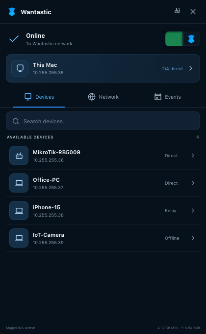
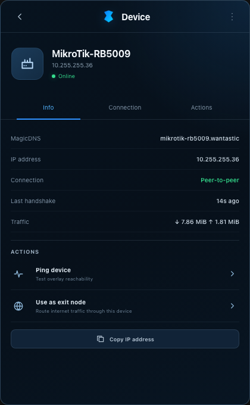
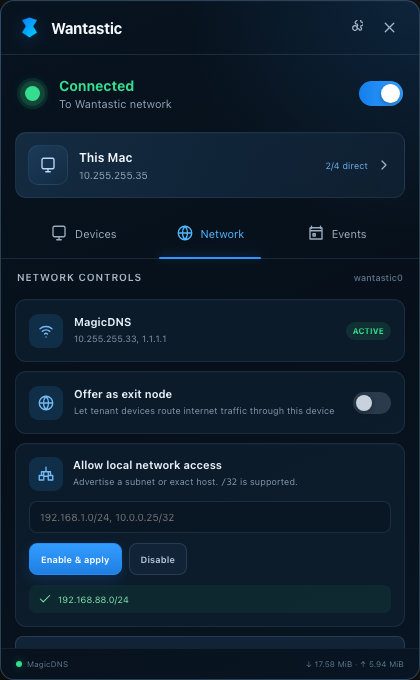
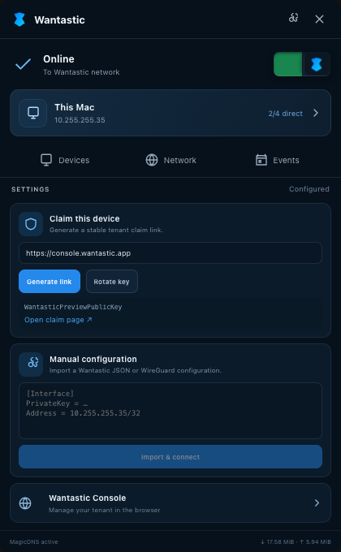
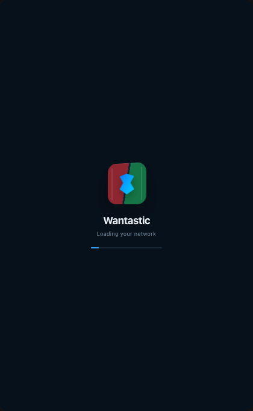

<div align="center">


# Wantastic Desktop

**A compact system-tray app for joining and managing your Wantastic tenant network.**

[](https://github.com/WantasticApp/wantasticd/actions/workflows/desktop.yml?query=branch%3ADesktop)
[](https://v3.wails.io/)
[](#download)

[Download the latest successful Desktop build](https://github.com/WantasticApp/wantasticd/actions/workflows/desktop.yml?query=branch%3ADesktop+is%3Asuccess)

</div>

The `Desktop` branch is dedicated to the Wantastic Wails v3 desktop app. It
contains the frameless tray window, native platform packaging, desktop tests,
and the shared networking agent used by the app.

For the headless `wantasticd` daemon and router installation workflow, use the
[`main` branch](https://github.com/WantasticApp/wantasticd/tree/main).

## Screenshots

<p align="center">
  
  
  
</p>

<p align="center">
  
  
</p>

## What the desktop app provides

- Wantastic status beside the native system-tray icon
- connect and disconnect control
- tenant device list with direct, relay, and offline path status
- device details, traffic, last handshake, MagicDNS name, and overlay IP
- short multi-sample device ping visualization
- stable claim-link generation with automatic connection after claiming
- manual Wantastic JSON or WireGuard configuration import
- MagicDNS status and tenant DNS information
- exit-node offering and selection, gated by peer advertisement
- opt-in local-network access with private subnet or `/32` host routes

Direct P2P is attempted automatically. When NAT or a firewall prevents a safe
direct UDP path, the encrypted tenant relay remains the availability fallback.

## Download

Desktop builds are currently published as artifacts by the
[`Desktop` GitHub Actions workflow](https://github.com/WantasticApp/wantasticd/actions/workflows/desktop.yml?query=branch%3ADesktop+is%3Asuccess).

1. Open the latest successful workflow run.
2. Scroll to **Artifacts**.
3. Download the artifact for your operating system.
4. Extract the downloaded ZIP before launching the application.

| Operating system | Artifact | Package contents |
|---|---|---|
| macOS 13+ | `wantastic-desktop-macos-universal` | Universal Intel and Apple silicon app ZIP |
| Windows 10/11 x64 | `wantastic-desktop-windows-amd64` | `wantastic.exe` |
| Linux x86_64 | `wantastic-desktop-linux-amd64` | `wantastic` GTK 3 binary |

GitHub currently requires signing in to download Actions artifacts. These are
development builds: macOS is ad-hoc signed and Windows uses an ephemeral
self-signed CI certificate. Publicly trusted notarized/Authenticode installers
are not published yet.

### macOS

1. Extract the downloaded artifact.
2. Extract `wantastic-macos-universal.zip` inside it.
3. Move `Wantastic.app` to `/Applications`.
4. On first launch, Control-click the app, choose **Open**, and confirm macOS.
5. Approve the administrator prompt when Wantastic starts its tunnel helper.

The Wails window remains unprivileged. Only the native tunnel helper receives
administrator rights. Local-network access uses a dedicated
`com.apple/wantastic` PF anchor and restores the previous forwarding state when
it stops.

### Windows

1. Extract the downloaded artifact.
2. Run `wantastic.exe`.
3. If SmartScreen warns about the CI certificate, verify that the file came
   from the official Wantastic workflow before choosing **Run anyway**.

The desktop UI is built with an `asInvoker` manifest and does not request
process-wide administrator rights. Native tunnel or firewall operations still
depend on the permissions and service policy configured on the machine.

### Linux

Install the GTK/WebKit/AppIndicator runtime libraries. On Ubuntu 24.04:

```sh
sudo apt-get update
sudo apt-get install -y libgtk-3-0 libwebkit2gtk-4.1-0 libayatana-appindicator3-1
```

Then extract and launch the artifact:

```sh
chmod +x wantastic
./wantastic
```

Creating a native TUN requires an administrator-managed service or suitable
network capabilities. Do not run the desktop webview itself as root.

## First-time setup

### Claim this device

1. Open Wantastic from the tray.
2. Select the settings button in the upper-right corner.
3. Keep `https://console.wantastic.app` as the server unless you use a trusted
   self-hosted Wantastic deployment.
4. Select **Generate link**.
5. Open the claim page and approve the device in your signed-in tenant.

The app keeps the private device key on the computer, watches for the completed
claim, writes the returned configuration privately, and connects automatically.
Rotating the key creates a new device identity and should be used only when the
old identity must be replaced.

### Manual configuration

Open **Settings**, paste either a Wantastic JSON configuration or a standard
WireGuard client configuration, then select **Import & connect**.

```ini
[Interface]
PrivateKey = <DEVICE_PRIVATE_KEY>
Address = 10.x.x.x/32
DNS = <TENANT_DNS>, <FALLBACK_DNS>

[Peer]
PublicKey = <SERVER_PUBLIC_KEY>
Endpoint = wg.wantastic.app:51820
AllowedIPs = <TENANT_PREFIX>
PersistentKeepalive = 25
```

Never publish a real private key, enrollment token, or complete configuration
in an issue, screenshot, commit, or CI log.

## Daily usage

### Tray controls

- The tray label shows **Online**, **Offline**, **Connecting**, or **Setup**.
- Selecting the tray icon opens the compact Wantastic window.
- The tray menu provides connect/disconnect, Devices, Network, Settings, and
  Quit actions.

### Devices and ping

The **Devices** view shows all available tenant devices and whether each path is
direct, relayed, or offline. Select a device to view its address, MagicDNS name,
last handshake, traffic, and actions. **Ping device** records a short series of
overlay reachability samples rather than reporting only one packet.

### Exit nodes

Open **Network** to offer this computer as an exit node. On another device,
**Use as exit node** is enabled only after that peer has advertised exit-node
capability. Disabling the offer removes the capability advertisement.

### Local-network access

**Allow local network access** advertises a private LAN route to devices in the
same Wantastic tenant. Enter a private subnet or one host:

```text
192.168.50.0/24
192.168.50.25/32
```

Use `/32` to expose only one LAN host. Do not enter a Wantastic overlay address
such as `10.255.255.x`; overlay peers are already reachable. The app rejects
public prefixes, default routes, malformed routes, and routes overlapping the
tenant overlay before changing the tunnel or firewall.

## Build from source

Requirements:

- Go 1.27.2 or a compatible newer toolchain
- Node.js 22
- pnpm 11
- Wails v3 platform dependencies

```sh
# Inspect supported commands
make help

# Test Go, frontend dependencies, and installer syntax
make check
make test-desktop

# Regenerate bindings and build the frontend
make frontend-build

# Run development mode or build for the current platform
make desktop-dev
make desktop-build
```

Build and ad-hoc sign the universal macOS application on a Mac:

```sh
make desktop-macos-universal
```

The dedicated Desktop workflow tests the app and builds native Linux, macOS,
and Windows artifacts for every push to this branch.

## Security model

- the desktop webview remains unprivileged
- IPC listens only on loopback and requires a generated bearer credential
- browser-originated mutation requests are rejected
- configuration and claim-key files use private permissions and no-follow checks
- local-access routes are bounded, normalized, private IPv4 prefixes
- macOS PF changes are limited to Wantastic's dedicated anchor
- Windows UI packaging retains the non-elevated `asInvoker` manifest

Report security issues privately rather than including keys, configurations, or
tenant details in a public GitHub issue.

## License

See [LICENSE](LICENSE).
